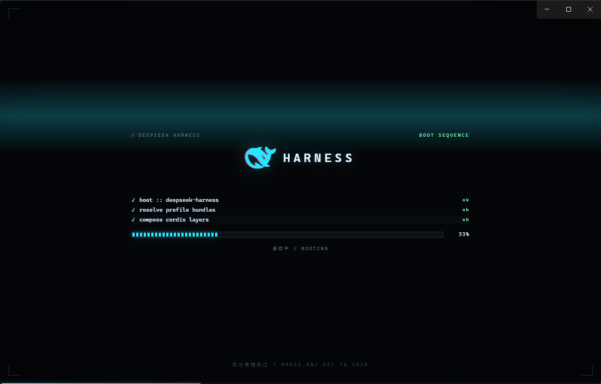

# dsh-splash

**DeepSeek Harness 的赛博朋克启动画面。** 透视网格、CRT 扫描线、霓虹鲸鱼、逐行滚动的启动日志、与日志共用一条时间轴的进度计，最后以 CRT 塌缩收场。在 React 挂载**之前**就铺满屏幕，默认 10 秒，**按任意键或点击任意处跳过**。




> 非官方第三方插件，与 DeepSeek 无隶属关系；鲸鱼标志的权利归其所有者。见 [NOTICE.md](NOTICE.md)。

- **零依赖、零构建**：纯 JS，没有打包步骤，clone 下来就是能跑的插件
- **自带三道门禁**：冒烟 + 设置页（真渲染）+ 控制器（真执行），`npm test` 一条命令跑完，CI 在 Ubuntu 与 Windows 上跑 Node 20/22
- **两种环境同一份代码**：Electron 桌面应用与 `dsh web`
- **一个独立设置页**：启用、配色、动画时长、兜底超时、预览、恢复默认

---

## 目录

- [一眼看懂它怎么工作](#一眼看懂它怎么工作)
- [动画](#动画) · [配色预设](#配色预设) · [设置页](#设置页)
- [硬约束](#两个必须先接受的硬约束)（想改它之前先读这节）
- [安装](#安装) · [配置](#配置) · [热更新边界](#热更新边界) · [回滚](#回滚)
- [验证](#验证) · [tools](#tools) · [扩展](#扩展)
- [兼容性](#兼容性) · [权限与风险](#权限与风险) · [许可](#许可)

---

## 一眼看懂它怎么工作

DSH 的启动画面分两段，**插件只能在第一段上桌**：

```
内核加载卡片(BootPage, framework-free)
        │  ← 宿主 webserver/index-inject 行在这里插进来
        ▼
React 挂载(BootHandoff)  →  应用界面
        │  ← 客户端半侧的 shell.overlay 条目在这里出现
        ▼
```

- **宿主半侧 `index.js`** 监听 `webserver/index-inject`，推入 6 行：`global(config)` → `global(prelude)` → `script(head)` → `style` → `html(body)` → `script(body)`。
  - `script(head)` 打开 `<html data-dsh-splash-state>`，`style` 里的 `html[data-dsh-splash-state="on"] [data-dsh-boot]{display:none!important}` 于是**在内核创建加载卡片之前**就生效。
  - `html(body)` 是整个动画的 DOM（FX 层 + 舞台 + 日志 + 进度计 + 时间轴），`script(body)` 是控制器（`controller.js` 的原文）。
  - 两条 `global` 行分别送配置与控制器的构建期常量——控制器因此是一个**真实文件**，能被 `node --check` 直接看住。
- **客户端半侧 `client.js`** 只做两件事：注册一个与「通用设置」同级的设置页，以及往 `shell.overlay` 塞一个返回 `null` 的条目——它一旦挂载就说明应用框架真的渲染了，是控制器的第二就绪信号。
- **持久化**：`$DSH_HOME/dsh-splash.json`，由插件自己的两条 exact 路由读写。

设置页的读写链路：

```
设置页 → fetch('dsh-splash.set') → 宿主 exact 路由（connection 围栏 + 范围校验）→ 原子写 dsh-splash.json
下次索引渲染 → emit 时 readFileSync → 行内容随之变化
```

---

## 动画

### 10 秒的一圈

**进度计和日志共用同一条时间轴**：进度 = 已播时长 ÷ 动画时长，匀速从 0 走到 100%；日志第 n 行落在进度跨过 `n/(N+1)` 的那一刻。10 行脚本 + 收尾的 `ready`，正好铺满一圈——条和字一起走完，谁也不提前到站。

| 进度           | 发生什么                                                                           |
| ------------ | ------------------------------------------------------------------------------ |
| 0%           | 霓虹与网格淡入；鲸鱼以 RGB 分离抖一下定住；时间轴底线开始走                                               |
| ~9%          | 日志第 1 行落下，140ms 后点亮 `ok` 徽标并闪一下                                                |
| ~9% → ~91%   | 之后 9 行按进度等距落下                                                                  |
| ~91%         | 脚本走完：已就绪 → 打 `ready` 并推到 100%；未就绪 → 打 `awaiting application frame` 并每 400ms 轮询 |
| 100%（= 动画时长） | 若已就绪，CRT 塌缩收场并移除自己——**收场就落在 100% 上**                                           |
| 兜底超时（默认 30s） | 仍不就绪 → 切 `stuck` 态，显示「继续」按钮，**不淡出**（见下）                                        |

改 `minDurationMs` 就能改这一圈的长度，日志的节奏与进度计会一起重排——预览时长 5.2 秒时，同一套逻辑会把 10 行压缩进 5.2 秒。

**进度计不再是内核激活进度的镜像。** 旧实现读内核卡片的 `--dsh-boot-arc`，快机器上它在 2 秒就到顶，进度条冻在 100% 看完剩下的 8 秒，和日志彻底脱节。现在的进度计是**动画自己的时间轴**；真实的就绪信号是收场时刻本身——条走满、界面就绪，两者同时发生。

### 视觉层次

- **FX 层**（`aria-hidden`）：透视网格地面（`rotateX` + mask，2.6s 循环滚动）、CRT 扫描线（2px 周期）、缓慢下扫的霓虹光带、暗角、四角 HUD 角标。
- **舞台**：顶栏 kicker（跳动的品红指示灯 + `BOOT SEQUENCE`）、鲸鱼 + `HARNESS` 字标（RGB 分离 `drop-shadow` + 4.6s 一次的故障抖动 + 7.2s 一次的亮度闪）、终端日志、分段进度计（`[████░░░░] 42%` 风格）、状态行。
- **收场**：`is-leaving` 时舞台按 `steps(5)` 挤成一条扫描线并提亮——CRT 关机的手感。
- **全局等宽字体**：整屏用 `ui-monospace` 栈，这是「代码开发」主题的主要载体。

### 日志文案

日志按**真实工具链输出**写（`resolve profile bundles` / `compose cordis layers` / `link client bundles` / `mount application frame` …），不翻译。原因很直接：翻译过的构建日志读起来既不像编译器也不像中文。其余面向人的文案（状态行、跳过提示、`stuck` 态、设置行）都按 `navigator.language` 中英切换。

### 跳过

**任意键**、或点击浮层任意处。纯修饰键（`Shift` / `Ctrl` / `Alt` / `Meta` / `CapsLock` / `Tab`）忽略，带修饰键的组合也忽略，免得吃掉应用快捷键；只有会滚动页面的键（空格、方向键、Page*、Home/End、Backspace）才 `preventDefault`。

跳过后会**删掉 `data-dsh-splash-state`**，于是内核加载卡片重新可见——不会跳出一片空白。

### 预览

设置页上的**预览**按钮走的是宿主半侧的 `globalThis.__DSH_SPLASH__.preview()`：

- 浮层如果已经收场被移除，预览会把它**重新挂回 `<body>`**，清掉塌缩态，清空日志，重置进度与时间轴，然后**从头重播整段动画**（约 5.2 秒后自己收场）。
- **预设会跟着走**。这条不是可有可无：配色是**宿主在渲染索引时钉进 markup 的 `data-ds-preset`**，而设置行改完预设会立刻把新 chip 点亮。如果预览不把浮层重新指向新配色，就会出现「chip 已经是新的、画面还是旧的」——这正是「预览没有展示我选的主题」的成因。所以：
  - `preview({ preset })` 接收设置行当前持有的值，先改 `data-ds-preset` 再重播；
  - `__DSH_SPLASH__.apply({ preset })` 用于**在不重播的情况下**把当前画面重新指向新配色（改预设时浮层刚好还在屏幕上时用得上）；
  - 两个入口都拿宿主广播的 `presets` 白名单校验，来自页面的值不会直接进选择器。
- **预览不受启用开关限制**——宿主侧的预览本来就无视 `enabled`。这正是「预览一个关掉的启动画面」的意义，所以按钮在开关关闭时**依然可用**。
- **但 `enabled` 刻意不能被实时打补丁**：那会让一次开关翻转把全屏浮层盖到设置面板上，而此时控制器早已收场、没有监听器能关掉它。不可跳过的满屏比配色不刷新糟得多，所以开关只在下次启动生效，它的提示文案也是这么写的。
- 浮层是从 `html` 行来的，而那一行由宿主半侧注入。如果宿主行还没生效（**桌面端装完没重启**），页面上就没有 `__DSH_SPLASH__`，预览**无处可调**。这种情况下按钮不再静默无反应，而是直接在行里说明原因：桌面端重启应用，浏览器端刷新页面。

### 超时不等于成功

桌面端的启动失败走 `desktop.failed()`，**不经过内核卡片的 `fail()`**，也就是说失败时 `[data-dsh-boot]` 可能永不消失。所以超时**不会**淡出浮层，而是切到 `data-dsh-splash-stuck`、换文案、显示「继续」按钮，让用户能看到底下真实画面/原生报错。

另外，若内核卡片出现 `Failed to load plugins`，控制器会立即收场，把报错界面还给用户。

### 减少动态

`@media (prefers-reduced-motion: reduce)` 会关掉网格滚动、光带、故障抖动、字标闪烁、日志入场动画与时间轴推进；仅保留静态版面与进度计。

---

## 配色预设

| id          | 观感                                             |
| ----------- | ---------------------------------------------- |
| `cyber`（默认） | 青 `#22e8ff` + 品红 `#ff3d9a`，近黑底，网格全开            |
| `synthwave` | 紫罗兰 `#c56bff` + 橙 `#ff9b3d`，紫黑底，网格全开           |
| `matrix`    | 磷光绿，网格全开                                       |
| `amber`     | 琥珀/CRT 暖黄，网格全开                                 |
| `mono`      | **跟随亮暗主题**（浅色底深墨 / 深色底浅墨），`--dsh-fx:0` 关掉网格与故障 |

`mono` 是唯一跟随主题的一档——霓虹不可能在浅色底上成立，所以浅色环境请用它。

设置行里的配色按钮**从宿主路由广播的列表渲染**，不是客户端硬编码；只有色块需要一份映射，遇到不认识的预设会退回中性点。所以加预设不需要改客户端。

---

## 设置页

导航里与「通用设置」同级的独立页：`settings.section`，`id: splash`。**order 不写死**：注册时读一次 slot 台账，取「除自己之外的最大 order + 1」——今天内置依次是通用 0、模型 10、插件 15、预设 20、归档 25，所以落在 26；将来谁挪动或新增，它都自动跟到最下面。自己的旧座位会被排除（贡献器重跑时不会自己追自己往上爬），台账为空时回退到 100（仍低于今天所有内置 section）。它**不是**「通用」里的一行——这些都是启动画面自己的值，没有一项属于应用级通用偏好。外壳只提供内容列的内边距与滚动，页面自己画行。

| 项      | 控件            | 说明                                      |
| ------ | ------------- | --------------------------------------- |
| 启用启动画面 | 开关            | 关闭后不覆盖内核加载卡片                            |
| 霓虹配色   | 色块 chip       | 五个预设，列表来自宿主广播                           |
| 动画时长   | **可输入**数值 + 秒 | `minDurationMs`，默认 10 秒；上限 = 兜底超时 − 1 秒 |
| 兜底超时   | **可输入**数值 + 秒 | `maxTimeoutMs`，默认 30 秒；下限 = 动画时长 + 1 秒  |
| —      | 预览 / 恢复默认     | 预览重播动画；恢复默认删除配置文档                       |
| 配置文件   | 只读路径          | 可直接手改，宿主下次渲染索引时读到                       |

**界面说秒，存储是毫秒。** 配置文档、控制器与 markup 的 `--dsh-hold` 全都是毫秒，换存储单位会破坏已有文档和那条 CSS 变量，所以「秒」只是页面的一层呈现，换算只发生在页面里。输入框接受 `12`、`2.5`，也容忍粘贴来的 `12s` / `12秒`；回车提交，`Esc` 取消。

四个要点：

- **边界与路径由宿主广播，页面不自己抄一份。** 范围、步长、那条只读路径、以及「兜底超时必须高出动画时长的差值」（`minGapMs`）都来自 `GET /dsh-splash.config`，连描述文案里的「0–29 秒」也是用 bounds 插进去的。宿主换了上限，页面跟着换。
- **写入口只有一条**：`POST /dsh-splash.set`，范围在宿主侧校验（整数、上下界、配对），越界返回 400 并说明范围，不信任页面传来的值。页面在发送前先夹取，所以正常操作不会撞到 400。`reset: true` 是**删掉**配置文档而不是把默认值写进去——「默认」就是「没有覆盖」。
- **动画时长不得超过兜底超时。** 两者在页面上**互相收窄**：动画时长的上限是「兜底超时 − 1 秒」，兜底超时的下限是「动画时长 + 1 秒」，所以从界面上就不可能配出一个越界的组合。直接调路由或手改文档配出越界时，**路由拒绝**并说清两侧各是多少秒；而**读取路径**仍会把越界夹成合法值——手改的文件不该让启动起不来。
- **输入类字段的显示一律跟随生效值。** 正在编辑时才用草稿；没在编辑时直接渲染属性值。这条不是风格问题：早先版本用「依赖渲染值的 effect」把草稿同步回来，结果宿主把值**修正回编辑前的那个数**时依赖没变化、effect 不跑，字段就停在你键入的数，而生效的是另一个数。

---

## 两个必须先接受的硬约束

### 1. 桌面端做不到「零闪烁」

- **Web 端（`dsh web`）**：注入行内联进 index.html 文本，head 的 `style` 在第一帧就已生效 → **原生加载卡片一帧都不出现**。
- **桌面端（Electron）**：`apps/desktop/src/web-document.ts` 只往 `<head>` 内联 `__DSH_BOOT_READY__`，**不内联任何注入行**；注入行要等自有的 Host 进程就绪后才经 IPC 交给渲染端。而 `reconcileBackend` 是**先 navigate 再 start host**。所以：
  > **Host 就绪之前的原生加载卡片，插件层面无法消除。**
  插件能保证的是：Host 就绪后所有行在一个微任务里落地（head 脚本 → style → html → controller，中间不让出），所以**不会出现原生卡片与浮层同帧叠影**。为了切换不刺眼，浮层底色与窗口底色对齐。

  连带的现实是：桌面端那 10 秒动画实际播在 Host 就绪**之后**，所以大部分等待时间你看到的是原生卡片，动画集中在后半段。把 `minDurationMs` 调小可以让它更贴近真实节奏。

### 2. `link:` 挂载的零构建插件解析不了 `@deepseek-ai/*`

`resolver.ts` 的判定是 `scoped = startsWithin(parent, profileUrls)`，基于 **realpath 之后**的路径；`link:` 进来的插件真实路径在 profile 作用域之外（哪怕同一个盘），于是退回 Node 原生解析并失败：

```
$ node -e "createRequire('<你的 checkout>/index.js').resolve('@deepseek-ai/schemastery')"
MODULE_NOT_FOUND
```

因此：

- 宿主半侧**只用 node 内置模块**（`node:fs` / `node:path` / `node:os`）。
- **不走官方 settings 命名空间**：`settings.register(ns, schema)` 需要真实的 schemastery schema，拿不到就无法注册；本插件改用自有 JSON + 路由，用的仍是官方扩展点（`webserver/index-inject`、`ctx.webServer.register`、`ctx.slots`、`ctx.locale`）。
- 品牌几何随包发布为生成的数据模块 `fish-path.js`（见下）。

客户端半侧的手写 bundle 也有边界：`factory(require)` **只解析 9 个平台种子词**（`packages/client/web/src/platform.ts` 的 `PLATFORM_MODULES`）：`react`、`react/jsx-runtime`、`react-dom`、`react-dom/client`、`@deepseek-ai/cordis`、`-dsh-client-store`、`-dsh-client-ui-slots`、`-dsh-client-ui-primitives`、`-dsh-client-ui-dockkit`。**不能 `require` CSS**，样式自己 `document.head.appendChild(<style>)`。`ctx.locale` / `ctx.slots` 是 cordis 服务，从 `ctx` 拿。

### 控制器为什么是独立文件

`controller.js` 是一份**真实文件**，宿主启动时 `readFileSync` 读它的原文作为行内容，而不是写在 `index.js` 的模板字面量里。原因很实际：控制器曾经是个模板字面量，于是**注释里任何一个反引号都会把字符串提前闭合**，Node 报成毫不相干的 `Unexpected identifier`——这个坑连着踩了三次。挪成文件后注释自由了，`node --check controller.js` 直接看住语法，而且「测的就是发出去的」。构建期常量走一条 JSON 安全的 `global` 行（`__DSH_SPLASH_PRELUDE__`），所以控制器内部不需要字符串插值。

代价是**读一次就缓存**：改 `controller.js` 要重启宿主（桌面端重启应用，Web 端重启 `dsh web`）。这与 `cordis.patch.yml` 的边界一致；也正因为只读一次，装坏了会在组合时**大声失败**，而不是发一个没有浮层也没有解释的启动。

---

## 文件

| 文件                         | 职责                                                                        |
| -------------------------- | ------------------------------------------------------------------------- |
| `package.json`             | `dsh.bundle.patch` + `dsh.client` + `exports` + `scripts`                 |
| `index.js`                 | 宿主半侧：注入行、动画 CSS、markup、配置读写、两条路由                                          |
| `controller.js`            | 注入到页面的控制器（经典脚本；宿主启动时读其原文作为行内容，故 `node --check` 直接可查）                      |
| `client.js`                | 客户端半侧：设置页、i18n、帧活信号                                                       |
| `cordis.patch.yml`         | 插入本插件行（`hmr` 段默认注释掉，见「热更新边界」）                                             |
| `fish-path.js`             | **生成物**：鲸鱼 path（`tools/extract-fish-path.mjs`），权利见 [NOTICE.md](NOTICE.md) |
| `icon.svg`                 | 插件图标                                                                      |
| `LICENSE` / `NOTICE.md`    | MIT 正文 / 商标与素材来源声明                                                        |
| `.github/workflows/ci.yml` | 三道门禁 × Ubuntu+Windows × Node 20/22                                        |
| `tools/`                   | 见 [tools](#tools)                                                         |

`preview.html` 是生成物，**不入库**（`.gitignore`）；`npm run preview` 现生成。

---

## 安装

前提：一个能跑起来的 DSH（`dsh` 在 PATH 里，或桌面应用），Node ≥ 20。**没有其它依赖，没有构建步骤**。

**源码安装（一行）：**

```bash
dsh plugin --profile web add github:OWNER/dsh-splash
```

`dsh plugin` 转发给 pnpm，所以 `github:` 是合法 spec。**但这条路径我没有端到端验过**——验过的是下面的本地 checkout + `link:`。如果装完 `dsh` 报 `cannot resolve profile bundle`，跑一次 `node tools/link-profile.mjs web` 补链接（`link:` 是必现的，见下节）。

**本地 checkout（改代码时用这个）：**

```bash
git clone https://github.com/OWNER/dsh-splash.git
cd dsh-splash

# web（CLI 管理）
dsh plugin --profile web add link:$(pwd)

# 桌面端 profile 由 Electron 独占，CLI 会拒绝 plugin 命令，直接改 profile：
#   ~/.dsh/profiles/desktop/package.json
#   "dependencies": { "@local/dsh-splash": "link:/绝对路径/dsh-splash" }
#   "dsh": { "profile": { "bundles": [ …原有各项…, "@local/dsh-splash" ] } }
```

### 两条硬要求

**1. 必须在 `bundles` 列表末尾。** 排最后是为了让本插件的 patch 成为最后写入者（`- id: hmr` 之类是 last-write-wins）。排前面会被后面的 bundle 覆盖。

**2. 必须补上 pnpm 没做的链接。** 见下节。

```bash
node tools/link-profile.mjs web      # 或 desktop，可一次给多个
```

最后**重启 DSH 桌面应用**（web 端刷新页面即可）。桌面端的注入行是 Host 就绪时的**一次性快照**，宿主持久化变更必须重启才可见。

### ⚠️ pnpm 不会真的建立链接

`pnpm` 会把 `link:` 记进锁文件和 `package.json`，然后报成功——`Already up to date`、`+ @local/dsh-splash 1.0.0 <- …`——**却从不创建 `node_modules/@local/dsh-splash`**。已在 pnpm 11.7.0 与 11.21.0、`nodeLinker: hoisted` 与默认 isolated、清空 node_modules、以及全新 scratch 工程下复现：作用域目录被建出来，里面是空的。随后 `resolveBundleDir` 抛


```
dsh: cannot resolve profile bundle "@local/dsh-splash" from the dsh installation or …\profiles\web
```

插件管理器也会因此拒绝把包名写进 `dsh.profile.bundles`（要手动加）。

`tools/link-profile.mjs` 就是补这一步：只创建 pnpm 本该创建的 junction，幂等，可反复运行。任何 pnpm 命令之后重跑一次即可。

### 换成别的包名

`dsh plugin` 转发给 pnpm，所以任何 pnpm 能解析的 spec 都能用（`github:OWNER/dsh-splash`、registry 上的包等）。**但本仓库只在「本地 checkout + `link:`」这条路径上做过端到端验证**——其它装法的问题请开 issue。

改名只需三处（都是镜像，冒烟测试会告诉你漏了哪个）：`package.json` 的 `name`、`client.js` 的模块 `id`、`cordis.patch.yml` 的 `name`。改完重新 link 一次。


---

## 验证

```bash
npm test                  # 冒烟 + 设置页 + 控制器，三道门禁，不需要 DSH
npm run test:profile      # 需要 DSH checkout，见下
npm run preview           # 重新生成 preview.html（6 格实时画廊）
```

`npm run test:profile` 会用 Electron 同一条 `loadProfileDirectory` 组合 profile，断言本层真的落地、客户端 bundle 的位置对、`hmr` 没被本插件的 patch 破坏。它需要一个 DSH checkout：设 `DSH_CHECKOUT=<checkout 路径>`，或者把本插件放在 checkout 里面/旁边（自动向上寻找）。**找不到 checkout 时它跳过并以 0 退出**，所以 CI 不需要它。

三道门禁都能直接进 CI，见 [`.github/workflows/ci.yml`](.github/workflows/ci.yml)（Ubuntu + Windows × Node 20/22，`node --check` 另外单跑一遍）。

已验证过的行为（在 `dsh web` 上实测）：

| 项 | 结果 |
|---|---|
| boot graph 收录本插件 | `{"id":"@local/dsh-splash","url":"/plugins/@local/dsh-splash/client.js?rev=…"}` |
| bundle 路由 | `200`，`text/javascript` |
| head 里 state 脚本位置 | 在应用脚本之前（`@30511` < `type="module"` `@41728`） |
| 浮层相对 `#root` | 之前（`@42495` < `@56353`） |
| 默认配置 | `{"enabled":true,"preset":"cyber","presets":[…5 档…],"minDurationMs":10000,"maxTimeoutMs":30000,"bounds":{…},"configPath":"C:\\Users\\admin\\.dsh\\dsh-splash.json"}` |
| 数值边界 | `minDurationMs:-5` → `400 minDurationMs must be an integer between 0 and 599000`；`maxTimeoutMs:10` → `400 … between 1000 and 600000` |
| 配对不变量 | `{minDurationMs:60000,maxTimeoutMs:30000}` → `400 minDurationMs (60s) must not exceed maxTimeoutMs (30s)`；**文档未被写入**。手改出越界的文档在**读取时**被夹成合法值，且后续不相关的写入照常成功 |
| 恢复默认 | `{reset:true}` → `200`，回到 `min=10000 max=30000 preset=cyber`，且**配置文件被删除** |

设置页由 `tools/page.test.mjs` 在最小 React 上**真正渲染并驱动**后断言，14 个场景全绿——输入类字段的形态、未编辑不写入、`2.5` → `2500`、`12秒` → `12000`、越界夹取到**当前上限**、`abc` 拒绝并说明、`Esc` 取消不写入、聚焦选中、回车提交、箭头 +1 秒、**动画时长被兜底超时拦住、兜底超时被动画时长拦住、抬高兜底后动画时长可达宿主上限**、配色与恢复默认，以及 **nav order 按台账实测（最高其他项 +1、排除自己、跟随后来的更高项、空台账回退 100）**。

**尚未自动验证**：动画在真实浏览器里的观感（淡入、故障抖动的实际节奏、CRT 收场的视觉）、设置页的排版与输入框的聚焦态——这些得用眼睛看。`preview.html` 是把真实注入行塞进 iframe 跑真实控制器，本身就是最快的目视手段。
| 注入的动画 | `--dsh-hold:10000ms`、`dsh-grid` / `dsh-sweep` / `dsh-scan` / `dsh-hud` / `dsh-log` / `dsh-timelineFill`、启动日志首行、中英跳过提示均在页内 |
| `GET /dsh-splash.config` | 带 cookie `200`；无 cookie `401` |
| 未知路径 | `404` |
| 方法不符 | `405` + `allow: POST` |
| 非法预设 | `400 {"error":"preset must be one of cyber, synthwave, matrix, amber, mono"}` |
| 合法写入 | `200`，落盘 `$DSH_HOME/dsh-splash.json`，再次 GET 读回一致 |
| 失效预设值 | 配置文件里写旧名 `official` 时，注入回落 `cyber`（已实测） |
| 配置热读 | 改文件后**无需重启**，下次索引渲染即生效（Web 端） |

控制器（含预览路径）由 `tools/controller.test.mjs` 在假 DOM 上**真正执行**后断言，9 个场景全绿：

| 场景 | 断言 |
|---|---|
| 启动中 | 浮层挂载、关掉内核卡片、`--dsh-hold` 到位、facade 入口齐全、日志开始滚动、状态行来自语言环境、**渲染出的状态标记是真正的 `✓` 而不是转义字样** |
| 就绪收场 | hold 到达后自己移除，走的是 `is-leaving` 的 CRT 塌缩，并把内核卡片交还 |
| **预览：配色跟随** | 预览采纳设置行当前持有的配色（不是 markup 里那档）；`apply` 能重指向一块已站住的浮层；**白名单外的配色被拒**；不带参数的预览不会清空属性 |
| **预览（已收场后）** | 重新挂载、解除 `hidden`、清掉塌缩与 stuck 态、接管内核卡片、日志清零后**真的重新滚动** |
| **预览（自动收场）** | 在把 hold 设成 60 秒的前提下，预览仍在自己的 5.2 秒后收场，并交还内核卡片 |
| **预览（关掉开关时）** | 默认不覆盖任何东西，但预览**照样能演示** |
| **预览（反复调用）** | teardown 之后**不残留**任何动画帧——这条是回归用例 |
| 任意键 | 纯修饰键不跳过；普通键跳过并交还卡片 |
| 启动失败 | 立即让位给 `Failed to load plugins`，并解除内核卡片的隐藏 |

---

## 配置

`$DSH_HOME/dsh-splash.json`（默认 `C:\Users\admin\.dsh\dsh-splash.json`）。可只写部分字段。

| 字段 | 默认 | 说明 |
|---|---|---|
| `enabled` | `true` | `false` 时浮层带 `hidden` 出厂，不隐藏原生卡片、不监听就绪 |
| `preset` | `"cyber"` | `cyber` \| `synthwave` \| `matrix` \| `amber` \| `mono` |
| `minDurationMs` | `10000` | 动画时长（页面显示 10 秒）；也是收场的最早时刻。整数 0–599000 |
| `maxTimeoutMs` | `30000` | 兜底超时（页面显示 30 秒）。整数 1000–600000，且始终高于 `minDurationMs` |

**这里是毫秒，设置页显示秒**（1 秒 = 1000）。优先级：**持久化文件 > patch 行 `config` > 硬编码默认**。文件损坏、字段非法或数值越界 → 静默回落/夹取，动画照常工作。设置页的「恢复默认」= 删除该文件。

数值越界是**夹取**而不是报错：文档可以手改，而一个越界的时长不会响亮地失败，只会让启动画面行为怪异——那是最难排查的地方。

---

## 热更新边界

| 改动 | 生效方式 |
|---|---|
| `client.js` | `dsh-client-hmr` 约 500ms 轮询；`exports["./client"]` 直供源码 → **无需刷新页面** |
| `controller.js` | 宿主启动时读一次并缓存 → **必须重启宿主**（桌面端重启应用，Web 端重启 `dsh web`） |
| `index.js` / `cordis.patch.yml` | 同一 Host 进程内会重新 `apply`，但**桌面端已加载页面不会重新采集注入行** → 看宿主行变更必须**重启应用** |
| `SPLASH_CSS`（在 `index.js` 里） | 随注入行走，同上；Web 端刷新页面即可 |
| `dsh-splash.json` | Web 端：下次索引渲染即生效（刷新页面）。桌面端：注入行是快照，需重启 |

**`hmr` 段默认是注释掉的。** 想让宿主侧的改动自动重应用，得你自己在 profile 里给 `hmr.root` 加上本插件的绝对路径（`cordis.patch.yml` 里有注释模板）。仓库里不代填：那等于把某个人的机器路径发给所有人，而一条不存在的 root 只会让你对着「改了没反应」发呆。

调动画请用 `dsh web`：服务端每次渲染索引都重新 `collect`，刷新页面即可，而且能看到真正的零闪烁版本。更快的循环是 `npm run preview` —— 改完 `index.js` 跑一次，6 格画廊里全部预设一次看全。

---

## 回滚

- 从 profile 的 `package.json` 删掉 `dependencies` 与 `dsh.profile.bundles` 两处 → 重启。
- 或临时改配置：`{"enabled": false}` → 重启（保留安装）。
- 卸载 web 侧：`dsh plugin --profile web remove @local/dsh-splash`（之后同样要删掉残留的 junction）。

---

## tools

| 脚本 | 用途 |
|---|---|
| `extract-fish-path.mjs` | 从 checkout 里的 `@deepseek-ai/dsh-client-ui-primitives/src/FishLogo.tsx` 重新生成 `fish-path.js`（用法见 [NOTICE.md](NOTICE.md)）。DSH 升级后跑一次同步品牌几何 |
| `smoke.mjs` | 无需 DSH 的静态冒烟：行的种类与顺序、`</script` / `</style` 转义、**prelude 行内容可 JSON 往返且排在控制器之前**、生成的脚本能解析、配置优先级、**默认时长是 10s**、markup 钉住 `--dsh-hold`、动画元件齐全、**每个广播的预设都有对应调色板块**、控制器含任意键跳过与时间轴进度计（不再镜像内核卡片的激活进度）、**设置入口是顶层 section 且未同时注册成通用行、`label` 是函数、order 高于所有内置 section（钉在导航最下面）**、**页面暴露全部四个可配置项**、**路由的范围校验 / 配对不变量 / reset 删档**、**预览不被启用开关门禁且拿不到入口时会说明原因**、客户端 bundle 的 `apply` 接线（含「不得注册 `root`」） |
| `dom.mjs` | 执行控制器用的最小 DOM：元素树、属性选择器、classList、dataset、style、监听器、MutationObserver、rAF。**不是通用 DOM**——只覆盖控制器碰到的面，省得为了一个零依赖插件引入依赖。按**整张注入表**顺序执行 `global`/`script` 行，模拟真实的 `applyIndexInjections` |
| `react.mjs` | 渲染设置页用的最小 React：函数组件、带重渲染循环的 `useState`、浅比较依赖的 `useEffect`、`useCallback`。同样只覆盖页面用到的面 |
| `page.test.mjs` | 在 `react.mjs` 上**真正渲染**设置页并调用各处理函数，14 个场景：输入类字段的渲染形态、未编辑不写入、秒→毫秒换算、粘贴带单位的文本、越界夹取、非法输入拒绝并说明、`Esc` 取消、聚焦选中、回车提交、箭头步进、**两个时长互相收窄（越界夹取、落在当前值则不写）**、配色与恢复默认、**nav order 按台账实测而非写死** |
| `controller.test.mjs` | 在 `dom.mjs` 上**真正跑**控制器，9 个场景见上表。这是 `preview()` 唯一的测试——它只能从设置行点到，静态检查够不着 |
| `check-profile.mjs` | 用 Electron 同一条 `loadProfileDirectory` 组合 profile，断言本层落地、客户端 bundle 存在、`hmr` 没被本插件的 patch 破坏。**需要 DSH checkout**（`DSH_CHECKOUT` 或不设也行——自动向上找）；找不到则跳过并以 0 退出 |
| `link-profile.mjs` | 补齐 pnpm 漏掉的 junction（见「安装」）；包名从 `package.json` 读，改名不用改它 |
| `preview.mjs` | 用**真实产出的整张注入表** + 真实控制器生成 `preview.html`（6 格，整帧循环重载） |

`npm test` = 前三个（无需 DSH）；`npm run test:profile` 另外两个 profile。失败时以非零码退出。

---

## 扩展

- **加配色**：在 `index.js` 的 `PRESETS` 里加 id + 写一个 `[data-ds-preset="<id>"]` 调色板块即可。设置页会自动出现新按钮（列表来自路由），预览也会自动认它（白名单来自同一条 prelude 行）。想让按钮更好看，再可选地加 `client.js` 的 `preset.<id>` 文案与 `.dss-swatch[data-preset="<id>"]` 色块——不加也能用，文案回落到 id，色块回落到中性点。
- **改日志**：`index.js` 的 `LOG_SCRIPT`（顺序数组）经 prelude 行传给 `controller.js`；落行节奏不是固定间隔，而是按进度里程碑（第 n 行落在 `n/(N+1)`），所以改时长它自动重排。
- **改动画**：`controller.js`（行为与计时）与 `index.js` 的 `SPLASH_CSS`（外观）。改完先 `node --check controller.js`。
- **改时长**：`DEFAULTS.minDurationMs` / `BOUNDS`（宿主侧），或用户侧 `dsh-splash.json`（毫秒）。**界面单位在 `client.js` 的 `toSeconds` / `parseSeconds` 与 `unit.s`**：存储永远是毫秒，只在页面这一层换。
- **改输入行为**：`client.js` 的 `DurationField`（解析、夹取、回退、键盘）——在 `tools/page.test.mjs` 里补一条对应用例再改。
- **换素材**：改 `tools/extract-fish-path.mjs` 的来源，或直接在 `index.js` 的 `splashMarkup()` 里换 `<svg>`。
- **换文案**：控制器里的 `TEXT`（中英，按 `navigator.language`）；设置页文案在 `client.js` 的 `DICTS`，带 `{min}` / `{max}` 的会在渲染时按 bounds 填充。

## 兼容性

| 项 | 值 |
|---|---|
| 开发/验证时的 DSH | `0.1.6-alpha.2` |
| Node | ≥ 20 |
| 环境 | Electron 桌面应用、`dsh web` 都验过 |
| 依赖 | 无 |

DSH 还是 alpha，插件 API 会变。**它依仗的三个契约**（都在本文「硬约束」一节里解释了），任何一条变了这个插件就会坏，而且通常是**静默坏**：

1. 注入行的种类、顺序与 `global` 行的 `name`/`value` 语义
2. `[data-dsh-boot]` 这个内核卡片锚点（CSS 靠它隐藏、控制器靠它判断「还在卡住」）
3. `settings.section` 的 owner props 与 `label` 是函数

升级 DSH 后先跑 `npm test`（不需要 DSH）再跑 `npm run test:profile`（需要 checkout）。

## 权限与风险

装之前该知道它碰什么。没有一项需要联网，没有一项改 DSH 源码：

| 项 | 说明 |
|---|---|
| 本地文件 | 读/写 `$DSH_HOME/dsh-splash.json`（几行 JSON）。**没有别的文件访问** |
| 网络 | **零外部请求**：无遥测、无 CDN、无第三方服务 |
| HTTP 路由 | 自注册两条 exact 路由（`GET dsh-splash.config`、`POST dsh-splash.set`），走 DSH 的 connection 围栏：无 cookie 401、跨站与非 JSON 拒绝。仅本机 |
| 页面注入 | 官方 `webserver/index-inject` 插 6 行（2 × `global`、`script(head)`、`style`、`html(body)`、`script(body)`） |
| 界面占用 | 开启时用 `display:none!important` 隐藏内核加载卡片；关闭、跳过或启动失败都立即让位 |
| 依赖 | 无。不装任何 npm 包，不跑 install 脚本 |
| 品牌素材 | 鲸鱼 path 来自 DSH 官方 UI 资产，权利归 DeepSeek，**不在 MIT 覆盖内**。见 [NOTICE.md](NOTICE.md) |

## 许可

代码 MIT，见 [LICENSE](LICENSE)。

鲸鱼标志是 DeepSeek 的资产，**不在 MIT 覆盖范围内**，这里只作指明所装饰产品的名义使用；本插件与 DeepSeek 无隶属关系。细节与替换方法见 [NOTICE.md](NOTICE.md)。
